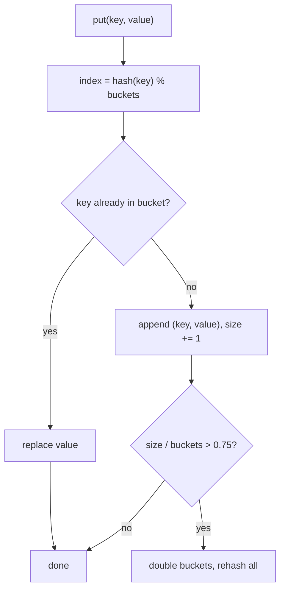
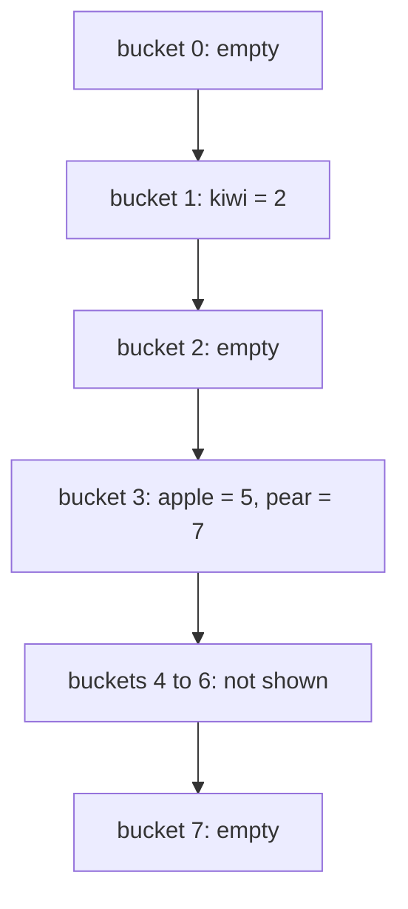

# 01. Hash table

A hash table maps a key to a value. A hash function turns the key into a bucket index, so a lookup goes almost straight
to the right place.

Code: [algo_01_hash_table.py](algo_01_hash_table.py). Tests: [algo_01_hash_table_test.py](algo_01_hash_table_test.py).

## The idea

Each bucket is a short list, called a chain. Keys that land in the same bucket sit in that list together. This is called
separate chaining.

## How it works

1. Hash the key, then take the result modulo the bucket count. That gives the bucket index.
2. `put`: scan that bucket. If the key is already there, replace its value. If not, append the pair and add one to the
   size.
3. `get`: scan that bucket and return the value, or `None` when the key is missing.
4. `delete`: scan that bucket and remove the pair.
5. After a new key is added, check the load factor (size divided by bucket count). When it is above 0.75, double the
   bucket count and put every pair back in. Each key gets a new index, so every pair moves.

## Flow

## Example

The bucket count is 8. The keys `"apple"` and `"pear"` both hash to bucket 3:

`get("pear")` computes index 3, scans two pairs, and returns `7`.

Resize example: after the 7th key, the load factor is 7 / 8 = 0.875, which is above 0.75. The bucket count becomes 16.

## Complexity

- `get`, `put`, `delete`: O(1) on average. The worst case is O(n), when every key lands in one bucket.
- Resize: O(n). It is rare, so the cost averages out over many inserts.

## Why it is useful

A lookup by key takes about the same time no matter how many items exist. A service can find a user session, a cache
entry, or the server that owns a key without scanning everything. Many other structures in this folder, such as the LRU
cache and the inverted index, build on it.

## Where it shows up

Caches, session stores, and key-to-server maps in sharded systems.

## Simplification in this code

The code uses Python's built-in `hash()`. That value changes between processes, so it is fine for one in-memory table.
Routing data across machines needs a stable hash, which is why [consistent hashing](algo_06_consistent_hashing.md) uses
SHA-256.
