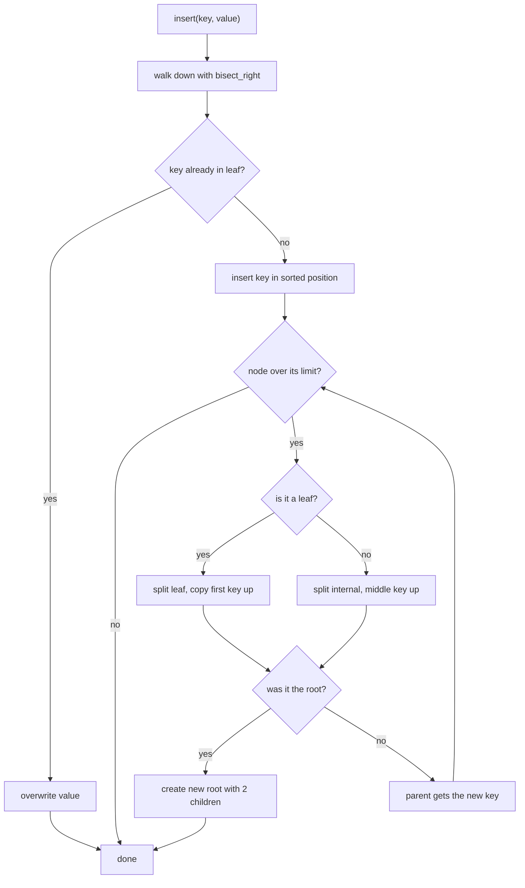
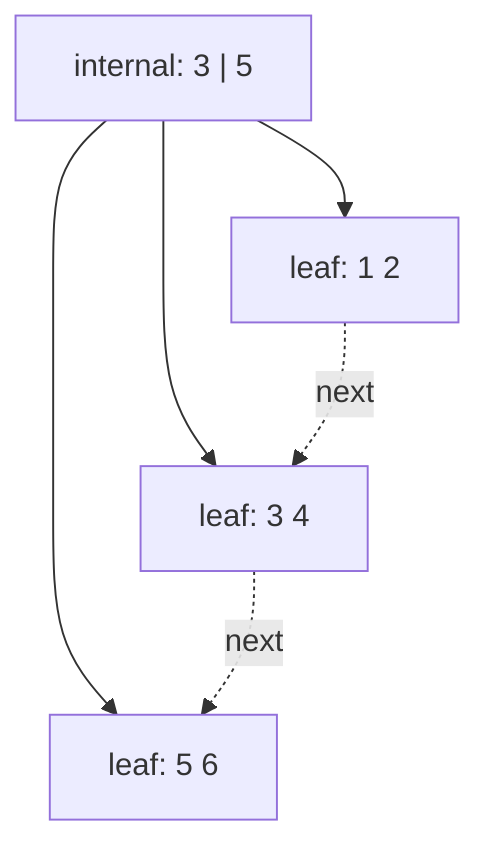

# 02. B+ tree

A B+ tree is a sorted index with many keys per node. All values live in the leaves. The leaves are linked in order, so a
range query can walk them one after another.

Code: [algo_02_b_plus_tree.py](algo_02_b_plus_tree.py). Tests:
[algo_02_b_plus_tree_test.py](algo_02_b_plus_tree_test.py).

## The idea

- Internal nodes hold separator keys and child pointers. They only guide the search.
- Leaves hold the real keys and values, sorted. Each leaf points to the next leaf.
- A node that gets too full is split in two. The tree grows from the top, so every leaf stays the same distance from the
  root.

## How it works

Search:

1. Start at the root.
2. In an internal node, use `bisect_right` on its keys to pick the child to follow.
3. Repeat until you reach a leaf, then binary-search the leaf for the key.

Insert: go down the same path. Put the key in the leaf in sorted order, then split if the node is too full.

- A leaf splits when it holds more than `order` keys. The right half keeps a copy of its first key, and that copy goes
  up to the parent.
- An internal node splits when it has more than `order` children. Its middle key moves up and is not kept in either
  half.
- If the root splits, a new root is created with two children. That is the only way the tree gets taller.

## Flow

## Example

Order 3. Insert 1, 2, 3, 4, 5, 6 in that order.

| Step           | Result                                                         |
| -------------- | -------------------------------------------------------------- |
| insert 1, 2, 3 | [1 2 3], one leaf, full                                        |
| insert 4       | [1 2 3 4] overflows, split: left [1 2], right [3 4], copy 3 up |
| insert 5       | [3 4 5]                                                        |
| insert 6       | [3 4 5 6] overflows, split: left [3 4], right [5 6], copy 5 up |

final tree:

Search 4: at the root, `bisect_right([3, 5], 4)` is 1, so go to the middle leaf and find 4.

Range 2 to 5: find the leaf for 2, then walk right through `[3 4]` and `[5 6]`, stopping at 6. The result is 2, 3, 4, 5.

## Complexity

- Search, insert: O(log n) node visits. Each node holds many keys, so the tree is shallow.
- Range scan: O(log n) to find the start, then O(k) for k results.

## Why it is useful

A hash table can find one exact key, but it cannot answer "all orders between two dates" without checking everything. A
B+ tree keeps keys sorted and gives both point lookups and range queries. Its high fan-out keeps the tree shallow, so a
lookup needs only a few disk reads even with millions of rows.

## Where it shows up

Most relational databases use this shape for their indexes, including PostgreSQL and MySQL InnoDB. Real B+ trees store
nodes as disk pages. This version keeps them as Python lists.

## Simplifications in this code

- No delete.
- Nodes are plain lists, not disk pages.
