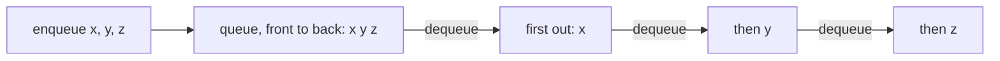
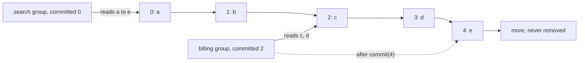

# 03. Work queue and append-only log

Two simple structures that show up in message systems:

- A **work queue** hands each item to one consumer, in first-in, first-out order. Once taken, the item is gone.
- An **append-only log** keeps every record in order. Each consumer group keeps its own offset, so groups can read at
  their own pace, and any group can replay from an older offset.

Code: [algo_03_queue_and_append_only_log.py](algo_03_queue_and_append_only_log.py). Tests:
[algo_03_queue_and_append_only_log_test.py](algo_03_queue_and_append_only_log_test.py).

## The idea

A queue removes items. A log only adds items. The log's offset is the position of a record, starting at 0. A consumer
group stores the next offset it wants to read. Reading does not move that offset. The group moves it forward with
`commit`.

## How it works

Work queue:

1. `enqueue` adds an item to the back.
2. `dequeue` takes the item at the front. It raises `IndexError` if the queue is empty.

Append-only log:

1. `append` adds a record at the end and returns its offset.
2. `read(offset, limit)` returns up to `limit` records from that offset. It does not change any stored offset.
3. `poll(group, limit)` reads from the group's committed offset.
4. The caller processes the records, then calls `commit(group, next_offset)` to move forward. If the caller crashes
   before the commit, the next poll sees the same records again.

## Flow

Work queue:

Append-only log:

producer: append(record) at the end

## Example

Three records are appended: `a` at offset 0, `b` at 1, `c` at 2. The `billing` group has never committed, so its
committed offset is 0.

- `poll("billing", 2)` returns `["a", "b"]`.
- `commit("billing", 2)` is called.
- `poll("billing", 2)` returns `["c"]`.
- `poll("search", 10)` returns `["a", "b", "c"]`, because that group still starts at 0.

Replay: `commit("reporting", 0)` moves the offset back. The next poll reads the log from the start again.

## Complexity

- Queue `enqueue` and `dequeue`: O(1). A `deque` removes from the front in constant time.
- Log `append`: O(1). `read` of k records: O(k).

## Why it is useful

The producer does not wait for the consumer, so a slow service does not slow down the service that sends it work. A log
also keeps history. A new consumer can start from the beginning, a failed consumer can replay what it missed, and each
group reads at its own speed.

## Where it shows up

Kafka, RabbitMQ, job queues such as Celery, and event sourcing. The idea behind a Kafka consumer group is the same as
the `committed` offset here.

## Simplifications in this code

- Everything lives in memory. A real log is written to disk and split into partitions.
- The queue has no acknowledgement step. A real broker tracks which items were acknowledged.
