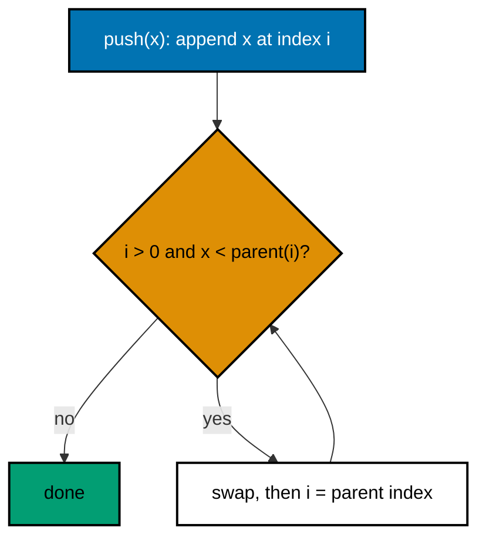
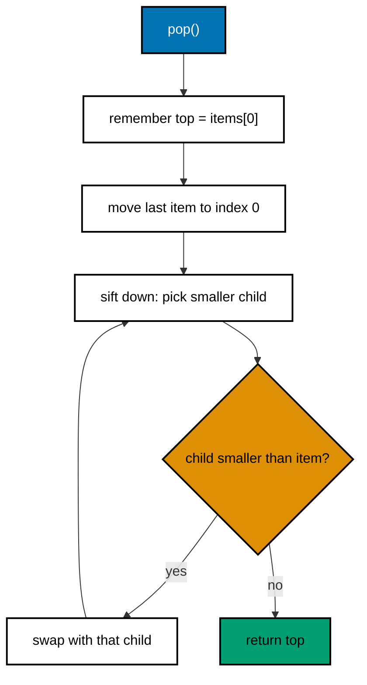
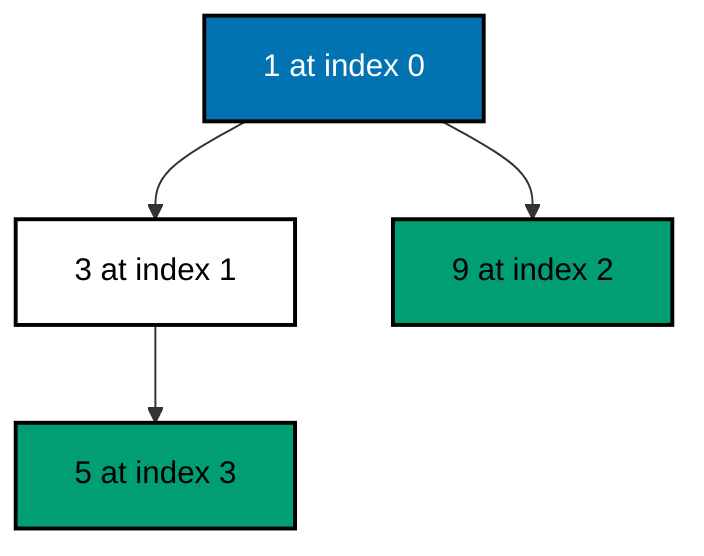

# 04. Heap (min-heap) and top-k

A min-heap is a tree where every parent is smaller than or equal to its children. The smallest item is always at the
top. It is stored in a plain list, with no pointers.

Code: [algo_04_heap.py](algo_04_heap.py). Tests: [algo_04_heap_test.py](algo_04_heap_test.py).

## The idea

In a list, the children of index `i` are at `2i + 1` and `2i + 2`. The parent of index `i` is at `(i - 1) // 2`. The
tree shape comes from these index rules alone.

Two operations keep the order correct:

- **Sift up**: after a push, move the new item up while it is smaller than its parent.
- **Sift down**: after a pop, move the item at the top down while one of its children is smaller.

## How it works

Push:

1. Append the item at the end of the list.
2. Sift up from that position.

Pop:

1. Remember the item at index 0. That is the smallest.
2. Remove the last item and put it at index 0.
3. Sift down from index 0.

Top-k (the k largest items): keep a min-heap of at most k items. For each new item, push it. If the heap now has more
than k items, pop the smallest. At the end, the heap holds the k largest.

## Flow

Sift up after a push:

Pop:

## Example

Push 5, 1, 9, 3 in that order. The tree after the pushes:

array: [1, 3, 9, 5]

- Push 5: `[5]`.
- Push 1: appended at index 1, then sifted up, because 1 is smaller than its parent 5. Result `[1, 5]`.
- Push 9: `[1, 5, 9]`.
- Push 3: appended at index 3, sifted up under 5, and stops under 1. Result `[1, 3, 9, 5]`.

Pop returns 1. The last item, 5, moves to the top: `[5, 3, 9]`. Sift down swaps 5 with the smaller child, 3. Result
`[3, 5, 9]`.

Top-2 of `[3, 8, 1, 9, 4, 7]` with a heap of size 2:

| Item | Heap after push | Too big? | Pop smallest | Heap   |
| ---- | --------------- | -------- | ------------ | ------ |
| 3    | {3}             | no       | none         | {3}    |
| 8    | {3, 8}          | no       | none         | {3, 8} |
| 1    | {1, 3, 8}       | yes      | pop 1        | {3, 8} |
| 9    | {3, 8, 9}       | yes      | pop 3        | {8, 9} |
| 4    | {4, 8, 9}       | yes      | pop 4        | {8, 9} |
| 7    | {7, 8, 9}       | yes      | pop 7        | {8, 9} |

The heap holds `{8, 9}`, which are the two largest items. Sorted from largest, the result is `[9, 8]`.

## Complexity

- Push and pop: O(log n). The tree has about log n levels.
- Peek: O(1).
- Top-k over n items: O(n log k).

## Why it is useful

Sorting everything just to find the smallest or largest item wastes work. A heap gives that item in O(1) and keeps the
order up to date in O(log n) per change. Top-k with a heap of size k needs only O(n log k), which is much less than
sorting all n items when k is small.

## Where it shows up

Schedulers that run the next due job, timers, rate-limited queues, and "top N" queries such as trending posts or the
largest files on disk.

## Simplifications in this code

- It is a min-heap only. For a max-heap, store negated values or reverse the comparison.
- Python's `heapq` does the same job. This code is hand-written to show the mechanics.
