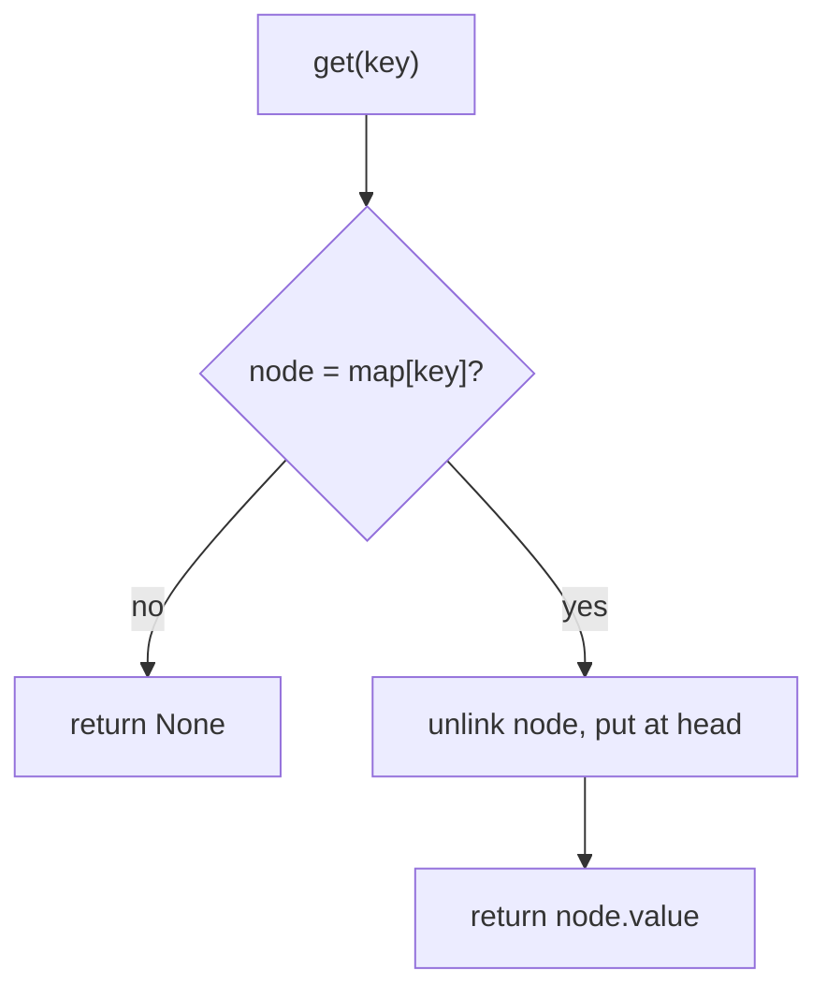
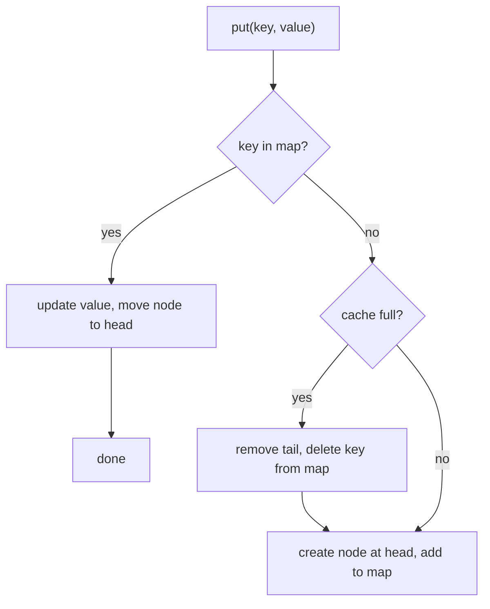

# 05. LRU cache

An LRU (least recently used) cache keeps a fixed number of items. When it is full and a new item arrives, it removes the
item that was used least recently.

Code: [algo_05_lru_cache.py](algo_05_lru_cache.py). Tests: [algo_05_lru_cache_test.py](algo_05_lru_cache_test.py).

## The idea

Two structures work together:

- A **hash map** finds any item by key in O(1).
- A **doubly linked list** keeps the items in order of use. The head is the most recent item. The tail is the least
  recent item.

A hash map alone cannot tell which item is oldest. A list alone cannot find an item quickly. Together, both are O(1).

## How it works

`get(key)`:

1. Look up the key in the hash map. If it is missing, return `None`.
2. If it is there, unlink its node from the list and put it at the head. Return the value.

`put(key, value)`:

1. If the key exists, update its value and move its node to the head.
2. If the key is new and the cache is full, remove the tail node. Also delete its key from the hash map.
3. Create a node, put it at the head, and store it in the hash map.

## Flow

get:

put:

## Example

Capacity 2. The list runs from the head (most recent) on the left to the tail (least recent) on the right.

| Step        | List, head to tail | Note                                 |
| ----------- | ------------------ | ------------------------------------ |
| put("a", 1) | [a]                |                                      |
| put("b", 2) | [b] <-> [a]        |                                      |
| get("a")    | [a] <-> [b]        | "a" moves to the head                |
| put("c", 3) | [c] <-> [a]        | cache is full, so evict the tail "b" |
| get("b")    | [c] <-> [a]        | returns None, since "b" is gone      |

## Complexity

- `get`, `put`, eviction: O(1). Every step is a pointer change or a hash lookup.

## Why it is useful

Memory is limited, but recent data is often requested again soon after. An LRU cache keeps that recent data close, so
most requests hit the cache instead of a slower source such as a disk or a database. Because `get` and `put` are O(1),
the cache itself does not become the bottleneck.

## Where it shows up

Application caches, database buffer pools, CDN edge caches, and the eviction policy of many key-value stores. Redis
offers an approximate LRU policy.

## Simplification in this code

The list uses `None` for missing neighbours, so the code has no dummy head or tail nodes. Python's `OrderedDict` could
replace both structures. This code does not use it, so the mechanics stay visible.
