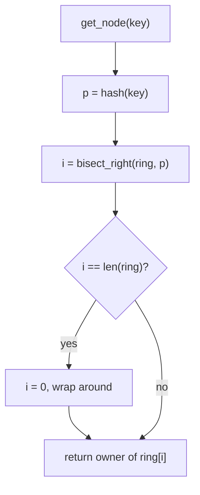
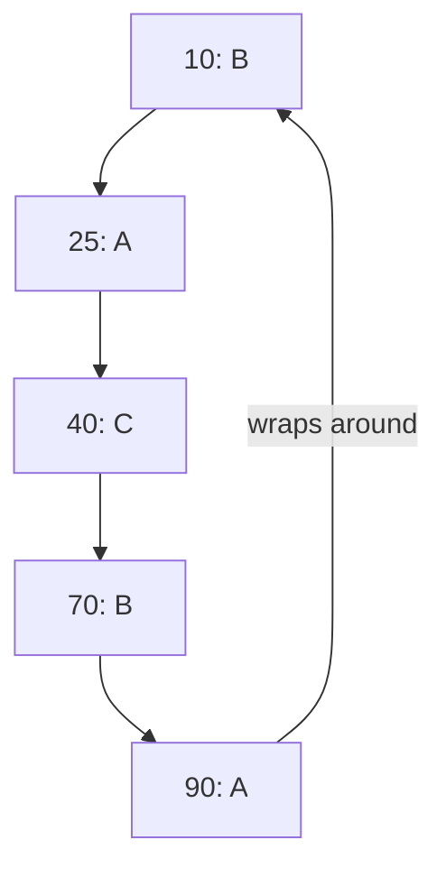

# 06. Consistent hashing

Consistent hashing spreads keys over a set of servers. When a server joins or leaves, only the keys that sit near it
move. Most keys stay where they are.

Code: [algo_06_consistent_hashing.py](algo_06_consistent_hashing.py). Tests:
[algo_06_consistent_hashing_test.py](algo_06_consistent_hashing_test.py).

## The idea

Put both servers and keys on the same circle of hash values, from 0 up to the largest value and then back to 0.

- A key belongs to the first server found going clockwise from the key's position.
- Each server appears on the circle many times as **virtual nodes** (for example, `cache-a#0` to `cache-a#99`). This
  spreads the load evenly.

Compare this with `hash(key) % number_of_servers`. That formula moves almost every key when the number of servers
changes.

## How it works

Add a node:

1. For each virtual node, hash its name to a position on the ring.
2. Store the position and its owner, then sort the positions.

Find the owner of a key:

1. Hash the key to a position.
2. Use binary search (`bisect_right`) to find the first ring position strictly greater than it.
3. If there is none, wrap around to position 0 (the first point on the ring).

Remove a node: delete all of its virtual positions. Keys that pointed to them now point to the next clockwise position.

## Flow

## Example

The ring has five virtual positions, each with an owner:

- Key at 33: the next position above is 40, so the owner is C.
- Key at 95: there is no position above 95, so it wraps to 10, so the owner is B.

Now add a node D at position 50. Only the keys in [40, 50) move, from B (position 70) to D. Every other key stays put.

## Complexity

- `get_node`: O(log v) for v virtual nodes, from the binary search.
- `add_node`, `remove_node`: O(v log v). The positions are sorted again.
- Keys moved per membership change: about 1 / n of all keys, where n is the number of servers.

## Why it is useful

With `hash(key) % servers`, adding one server changes the answer for almost every key. Every cache misses at once, and
data has to move between machines. Consistent hashing moves only about 1 / n of the keys, so a cluster can grow or
shrink without a large reshuffle or a wave of cache misses.

## Where it shows up

Dynamo, Cassandra, Memcached clients, and CDN routing. Each system has its own variant, but the ring idea is the same.

## Simplifications in this code

- Positions come from SHA-256, not `hash()`. This keeps every process on the same mapping.
- Nodes are stored in memory. A real system also replicates each key to the next few nodes on the ring.
