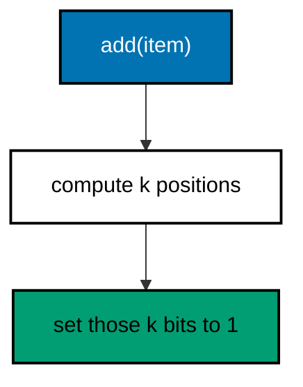
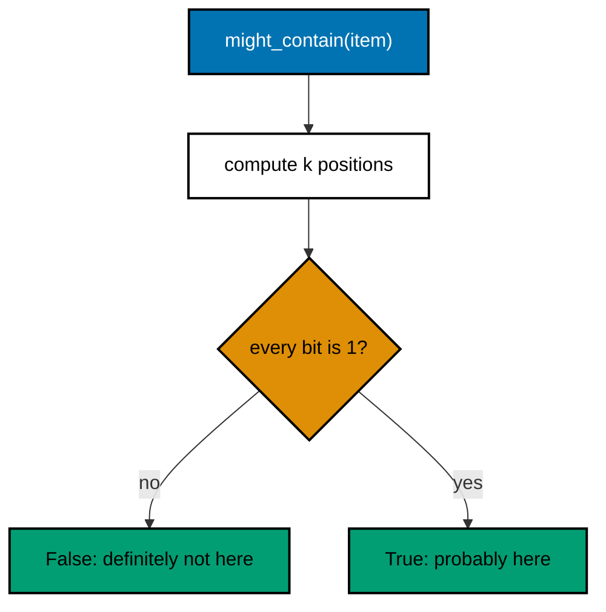

# 07. Bloom filter

A Bloom filter answers one question: "have I seen this item before?" The answer is one of two kinds:

- **No**: the item was never added. This answer is always correct.
- **Maybe yes**: the item was probably added. It can be a false positive.

It uses very little memory, because it stores only bits. It cannot remove items.

Code: [algo_07_bloom_filter.py](algo_07_bloom_filter.py). Tests:
[algo_07_bloom_filter_test.py](algo_07_bloom_filter_test.py).

## The idea

- Start with a bit array of `m` bits, all set to 0.
- Use `k` hash functions. Each one maps an item to a bit position.
- **Add** sets all `k` bits for the item to 1.
- **Check** looks at the same `k` bits. If any bit is 0, the item was never added. If all are 1, it probably was.

Other items can set the same bits, which is where false positives come from.

## How it works

The code gets all `k` positions from one SHA-256 digest with double hashing:

```text
position_i = (first + i * second) mod m
```

`first` and `second` come from the two halves of the digest. This gives `k` positions without `k` separate hashes.

Sizing: for `n` expected items and a target false-positive rate `p`:

- `m = -n * ln(p) / (ln 2)^2` bits
- `k = (m / n) * ln 2` hash functions

## Flow

add:



might_contain:



## Example

Bit array with 10 bits. Assume `"cat"` maps to positions 1, 4, and 8, and `"dog"` maps to 4, 6, and 9. These positions
are for illustration.

| Step                    | 0   | 1   | 2   | 3   | 4   | 5   | 6   | 7   | 8   | 9   |
| ----------------------- | --- | --- | --- | --- | --- | --- | --- | --- | --- | --- |
| empty                   | 0   | 0   | 0   | 0   | 0   | 0   | 0   | 0   | 0   | 0   |
| add("cat") sets 1, 4, 8 | 0   | 1   | 0   | 0   | 1   | 0   | 0   | 0   | 1   | 0   |

| Check                 | Positions        | Bits                 | Result                                           |
| --------------------- | ---------------- | -------------------- | ------------------------------------------------ |
| might_contain("dog")? | 4, 6, 9          | bit 4 = 1, bit 6 = 0 | False, definitely not added                      |
| might_contain("fox")? | 1, 4, 8 (as cat) | all three bits are 1 | True, but "fox" was never added (false positive) |

## Complexity

- `add` and `might_contain`: O(k).
- Memory: about 9.6 bits per item for a 1% false-positive rate.

## Why it is useful

A "no" is always right, so the system can skip an expensive step, such as a disk read or a call to another service,
whenever the filter says no. The filter uses very little memory, so it can cover a huge set of keys. The cost is some
extra work for false positives, which are rare when the filter is sized well.

## Where it shows up

- LSM trees (Cassandra, RocksDB) keep one filter per sorted file. A lookup for a missing key can skip reading the file
  from disk.
- Crawlers use one to skip URLs they have already seen.

## Simplifications in this code

- The filter cannot delete an item. Counting Bloom filters and cuckoo filters can.
- The code does not check the hash count against the bit count for very small filters.
