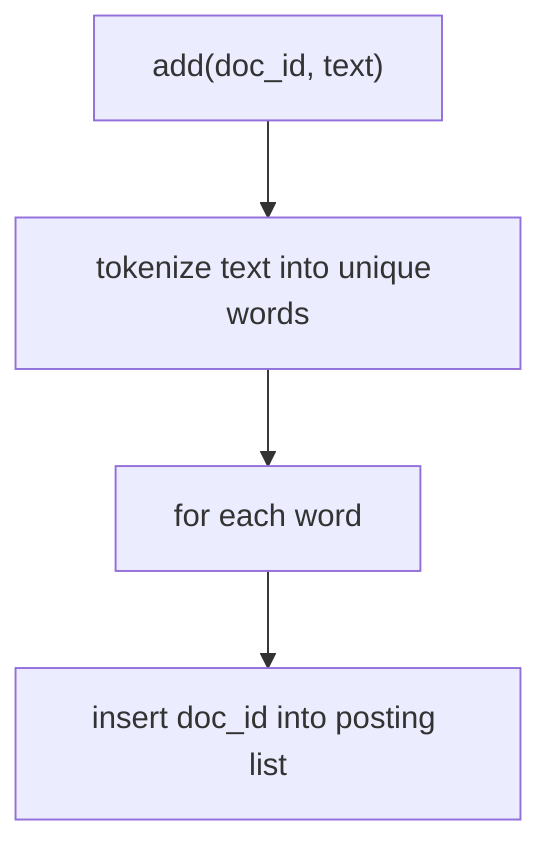
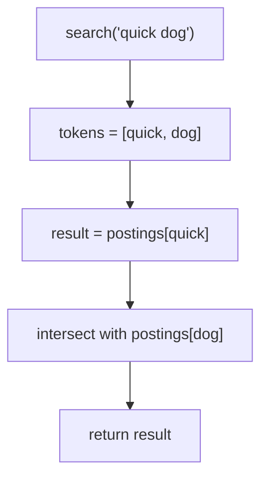

# 09. Inverted index

An inverted index flips the usual direction. Instead of "document -> words", it stores "word -> documents". To find
documents that contain a word, you look up the word once.

Code: [algo_09_inverted_index.py](algo_09_inverted_index.py). Tests:
[algo_09_inverted_index_test.py](algo_09_inverted_index_test.py).

## The idea

Each word (called a term) has a **posting list**: a sorted list of the document ids that contain it. An AND query such
as `quick dog` finds the documents that appear in both posting lists. Two sorted lists can be intersected in one pass.

## How it works

Add a document:

1. Split the text into lowercase words. Keep only letters and digits.
2. For each unique word, add the document id to that word's posting list, in sorted order. Skip it if the id is already
   there.

Search for `"w1 w2 ... wn"`:

1. Split the query the same way.
2. Start with the posting list of the first word.
3. Intersect that result with the posting list of each next word.
4. Return what is left. An unknown word has an empty list, so the whole result is empty.

## Flow

## Example

Three documents:

| Doc | Text                       |
| --- | -------------------------- |
| 1   | "The quick brown fox"      |
| 2   | "The lazy dog sleeps"      |
| 3   | "A quick dog runs quickly" |

postings:

| Term  | Posting list |
| ----- | ------------ |
| quick | [1, 3]       |
| dog   | [2, 3]       |
| fox   | [1]          |
| ...   | ...          |

Intersect `[1, 3]` with `[2, 3]` using two pointers. Each list only moves forward:

| Step | Compare | Action                               |
| ---- | ------- | ------------------------------------ |
| 1    | 1 < 2   | advance left                         |
| 2    | 3 > 2   | advance right                        |
| 3    | 3 = 3   | match, add 3 to result, advance both |

result: [3]

## Complexity

- Add a document with t unique words: O(t log p), where p is the size of each posting list. The log factor comes from
  keeping the list sorted.
- AND query: O(total length of the posting lists) with the two-pointer merge.

## Why it is useful

Scanning every document for a word is far too slow when there are millions of documents. The inverted index moves most
of the work to write time, so a search only touches the lists for its own words. Sorted posting lists also make AND
queries cheap. Search engines add ranking on top, but this structure is the base for finding the candidates.

## Where it shows up

Lucene, Elasticsearch, OpenSearch, and most full-text search features in apps. Search engines also store word positions
and term frequencies, so they can rank results and support phrase queries.

## Simplifications in this code

- Only AND queries. No OR, NOT, phrases, or ranking.
- Tokenizing only keeps `a-z` and `0-9`. Other languages need a better tokenizer.
- Everything is in memory.
