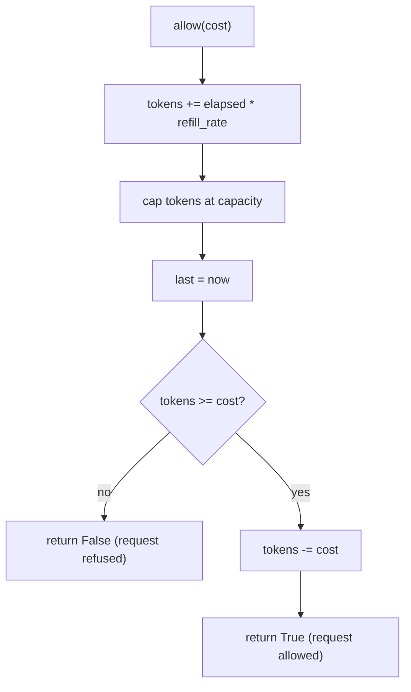

# 10. Token bucket

A token bucket is a rate limiter. Each client has a bucket that holds up to a fixed number of tokens. Each request takes
one token. Tokens come back at a steady rate. When the bucket is empty, the request is refused.

Code: [algo_10_token_bucket.py](algo_10_token_bucket.py). Tests:
[algo_10_token_bucket_test.py](algo_10_token_bucket_test.py).

## The idea

- **Capacity** is the most tokens the bucket can hold. It sets the largest burst.
- **Refill rate** is how many tokens return per second. It sets the long-run average rate.
- A bucket that has been idle is full, so a short burst is allowed. The average over time still stays at the refill
  rate.

## How it works

On each `allow(cost)` call:

1. Add the tokens earned since the last call: `elapsed * refill_rate`.
2. Cap the total at `capacity`.
3. If there are at least `cost` tokens, take them and return `True`.
4. Otherwise, take nothing and return `False`.

Refill is calculated from the time gap, not with a timer. Nothing runs in the background.

## Flow

## Example

Capacity 3, refill rate 1 token per second. The bucket starts full.

| Time | Event   | Tokens before | Result  | Tokens after             |
| ---- | ------- | ------------- | ------- | ------------------------ |
| 0.0  | allow() | 3.0           | allowed | 2.0                      |
| 0.0  | allow() | 2.0           | allowed | 1.0                      |
| 0.0  | allow() | 1.0           | allowed | 0.0                      |
| 0.0  | allow() | 0.0           | refused | 0.0                      |
| 1.0  | allow() | 1.0           | allowed | 0.0 (one token refilled) |
| 5.0  | allow() | 3.0           | allowed | 2.0 (capped at capacity) |

## Complexity

- `allow`: O(1). It does one subtraction, one multiplication, and one comparison.
- Memory: one bucket per client. Each bucket is three numbers.

## Why it is useful

A rate limiter protects a service from one client that sends too many requests. A plain counter per minute is unfair at
the edge of each window. A token bucket allows normal bursts, such as a page that makes ten calls at once, and still
limits the long-run rate. The check is O(1), so it adds almost no delay to each request.

## Where it shows up

API gateways and per-key limits in public APIs. Many cloud providers and proxies use a token bucket or a close variant
(see also [leaky bucket](algo_19_leaky_bucket.md) for smoothing traffic).

## Simplifications in this code

- The clock is passed in, so tests can move time forward. A real limiter uses the monotonic system clock.
- Each bucket is in memory. A distributed limiter needs shared storage, such as Redis, for all servers to agree.
