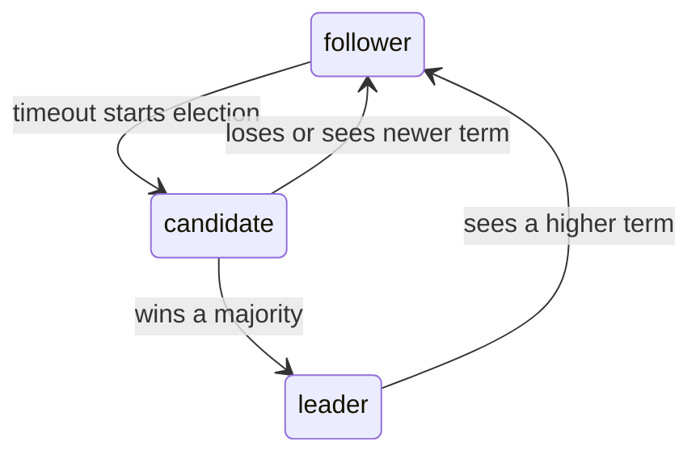
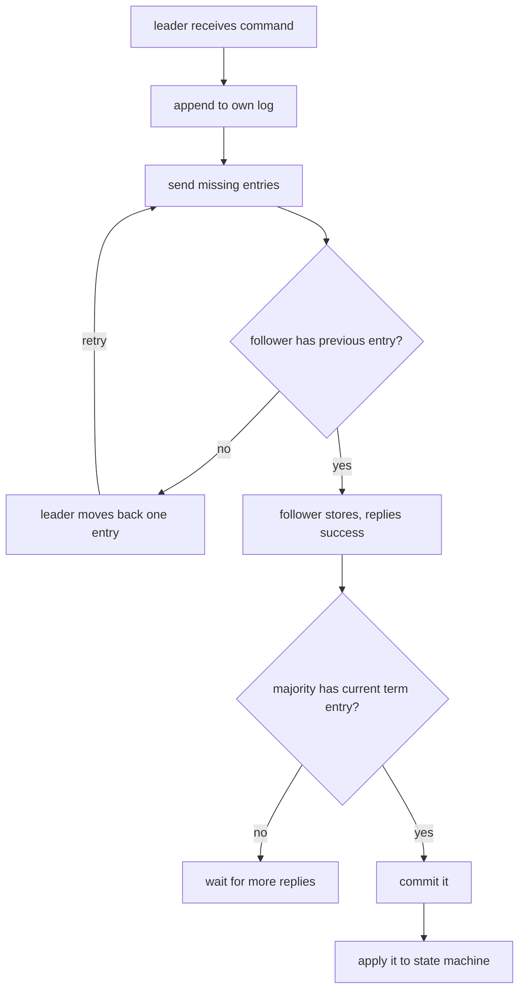

# 11. Raft (simplified)

Raft lets a group of servers agree on one ordered log of commands. As long as a majority of servers is alive and
connected, the group keeps working. A command counts as committed only after a majority stores it, so it survives when
the leader crashes.

Code: [algo_11_raft.py](algo_11_raft.py). Tests: [algo_11_raft_test.py](algo_11_raft_test.py).

## The idea

Each node is in one of three roles:

- Time is split into **terms**. Each term has at most one leader.
- A node votes for at most one candidate per term.
- A candidate wins only with a majority of votes. A majority of 5 nodes is 3.
- The leader accepts commands, sends them to the others, and commits each one after a majority stores it.

In this code there are no timers. The test code calls `elect` and `heartbeat` itself, so each step is visible.

## How it works

Election (`start_election`):

1. Increase the term and vote for yourself.
2. Ask every other node for a vote. Send your last log index and last log term.
3. A voter says yes only if the term is not old, it has not voted in this term, and the candidate's log is at least as
   up to date as its own.
4. With a majority of votes, become leader.

Replication (`replicate`):

1. For each follower, send the entries it is missing, plus the index and term of the entry just before them.
2. If the follower does not have that entry, it refuses, and the leader moves back one entry and tries again.
3. Once a majority has an entry from the leader's current term, the leader commits it.
4. Followers learn the new commit index from the next message, then apply the commands in order.

## Flow

## Example

Three nodes: 0, 1, 2. Node 0 wins term 1.

| Step                   | Node 0 log | Node 1 log | Node 2 log |
| ---------------------- | ---------- | ---------- | ---------- |
| elect(0)               | []         | []         | []         |
| submit("a")            | [a@1]      | [a@1]      | [a@1]      |
| node 0 fails, elect(1) | fails      | [a@1]      | [a@1]      |
| submit("b")            | [a@1]      | [a@1, b@2] | [a@1, b@2] |

Notes on the rows above:

- submit("a"): majority (3 of 3) stores a, so the leader commits a. Followers learn it next round.
- elect(1): term 2. Node 1 has [a@1], so its log is up to date. Node 2 votes for node 1: 2 of 3 is a majority.

result: "a" survives the leader change, and "b" commits under the new leader.

## Complexity

- One replication round: one message per follower. Each command is stored on every node.
- Election: one vote request per other node.
- A cluster of 2f + 1 nodes tolerates f failures.

## Why it is useful

Many systems need one agreed value or one ordered log that survives crashes. Raft gives that with a simple leader rule
and a majority check. A committed write is never lost, and a new leader always has every committed entry, so the group
stays correct after a failure. It is easier to understand than older protocols like Paxos, which is why many newer
systems use it.

## Where it shows up

etcd (the metadata store behind Kubernetes), Consul, CockroachDB, and TiKV.

## Simplifications in this code

- No timers. Elections start when the caller asks.
- No persistence. Real Raft writes the term, vote, and log to disk before replying.
- No network. Method calls replace RPCs, so message loss and delay are not modeled.
- No snapshots and no membership changes.
- Applying commands only updates a list of strings. A real system updates a database or state machine.
