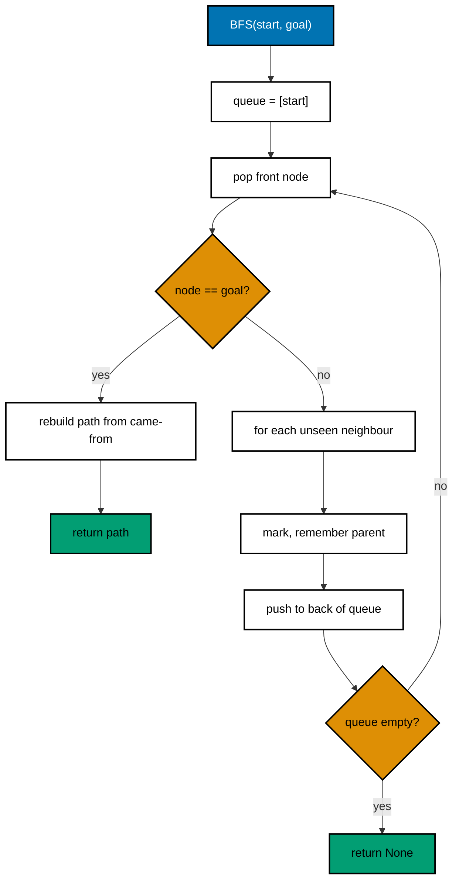

# 12. Graph search: BFS, topological order, and Dijkstra

A graph is nodes connected by edges. Many real problems are graphs: road maps, computer networks, friend lists, and task
dependencies. This file covers three basic searches.

Code: [algo_12_graph_search.py](algo_12_graph_search.py). Tests:
[algo_12_graph_search_test.py](algo_12_graph_search_test.py).

## The idea

- **BFS (breadth-first search)** explores in rings: first all nodes one edge away, then two edges away, and so on. On a
  graph with no weights, the first time it reaches a node is the shortest path.
- **Topological order** lists the nodes of a directed acyclic graph so that every edge points forward. It is valid only
  when the graph has no cycle.
- **Dijkstra** finds the cheapest path when edges have weights. It always settles the closest unsettled node next.

## How it works

BFS shortest path:

1. Put the start node in a queue. Remember where each node was first reached from.
2. Take the front node. If it is the goal, follow the "came from" links back to the start.
3. Otherwise, add each unseen neighbour to the back of the queue.

Topological order (depth-first search):

1. Visit a node. Mark it "on the path".
2. Visit all its neighbours first. If you reach a node that is still on the path, there is a cycle.
3. Mark the node done and add it to a list. The list is in reverse order, so reverse it at the end.

Dijkstra:

1. Set the start distance to 0. Put it in a min-heap.
2. Pop the closest node. Skip it if a shorter distance was already found.
3. For each neighbour, check whether going through this node is shorter. If so, update the distance and push it.

## Flow

## Example

BFS on edges `a -> b`, `b -> c`, `c -> d`, `a -> d`. Find the path from `a` to `d`:

| Queue  | Visit | New neighbours | Came from  |
| ------ | ----- | -------------- | ---------- |
| [a]    | a     | b, d           | b<-a, d<-a |
| [b, d] | b     | c              | c<-b       |
| [d, c] | d     | goal reached   |            |

path: d <- a, so [a, d]

Dijkstra on edges `a -> b (1)`, `b -> c (1)`, `a -> c (5)`:

| Heap   | Pop                    | Update                                      |
| ------ | ---------------------- | ------------------------------------------- |
| (0, a) | a                      | b = 1, c = 5                                |
| (1, b) | b                      | c via b = 2, which is less than 5, so c = 2 |
| (2, c) | c                      | nothing new                                 |
| (5, c) | skipped, because 5 > 2 |                                             |

result: a = 0, b = 1, c = 2

Topological order for `wake -> shower -> dress` and `wake -> breakfast -> dress`: one valid result is
`wake, breakfast, shower, dress`.

## Complexity

- BFS and topological order: O(V + E). Each node and edge is handled once.
- Dijkstra with a binary heap: O((V + E) log V).

## Why it is useful

Routing, social features, and build systems are all graph problems. BFS answers "how many hops", such as the degree of
connection between two people. Topological order answers "what can run now?" for build and deploy steps. Dijkstra gives
the cheapest route on a map or a network. The same ideas show up in dependency managers and CI pipelines.

## Where it shows up

- Map and navigation apps, and network routing protocols (OSPF and IS-IS use Dijkstra).
- Social graphs: "people you may know" uses BFS-style distance.
- Build tools and package managers: a topological order decides what to build first.

## Simplifications in this code

- Graphs are directed. For an undirected graph, add the edge in both directions.
- Dijkstra does not support negative weights. Use Bellman-Ford when weights can be negative.
- The topological sort returns an error on a cycle, but it does not report the full cycle.
