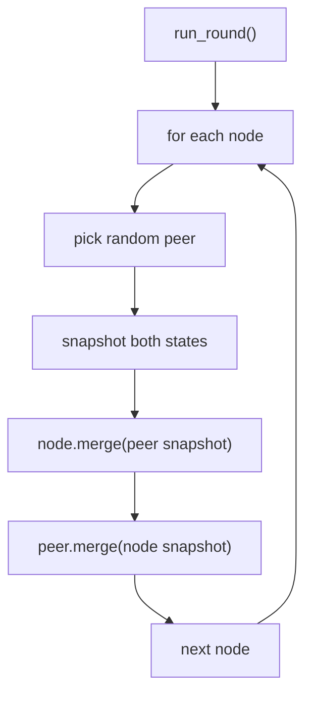
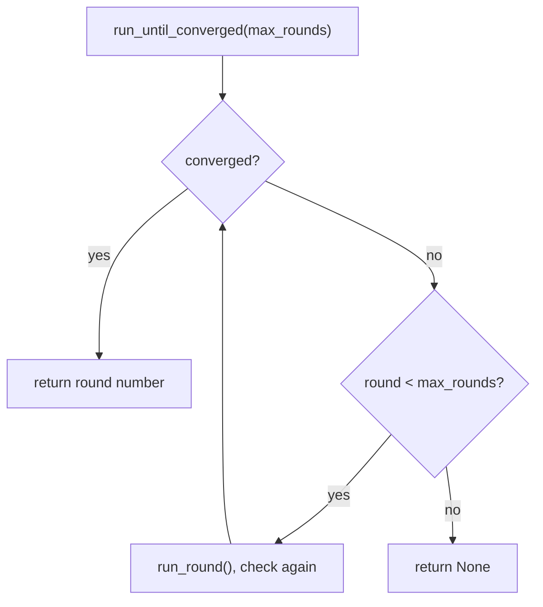

# 13. Gossip protocol

Gossip spreads information the way rumours spread. In each round, every node picks one random peer and they swap what
they know. Each key has a version number, and the higher version wins. After a few rounds, every node has the same
state. No central server coordinates this.

Code: [algo_13_gossip_protocol.py](algo_13_gossip_protocol.py). Tests:
[algo_13_gossip_protocol_test.py](algo_13_gossip_protocol_test.py).

## The idea

- **Push-pull exchange**: two nodes swap their full state. Each one keeps whichever version of each key is newer.
- **Rounds**: in each round, every node starts one exchange with a random peer.
- **Convergence**: the cluster has converged when every node has the same state.

Each node only talks to one peer per round, so the load is small and the same for every node.

## How it works

Write a key: the node increases the version of that key by 1. A brand-new key gets version 1.

Run one round:

1. For each node, pick a random peer.
2. Take a snapshot of both states.
3. Each side merges the other's snapshot. For each key, keep the entry with the higher version.

Check convergence: all nodes have the same state dictionary.

## Flow

## Example

Eight nodes. Node 0 writes `config = v1`. Each round, the number of nodes that know the value roughly doubles. One
possible spread:

| Round | Nodes that know config = v1 | Note                   |
| ----- | --------------------------- | ---------------------- |
| 0     | {0}                         |                        |
| 1     | {0, 3}                      | node 0 picked node 3   |
| 2     | {0, 1, 3, 6}                | 0 picked 1, 3 picked 6 |
| 3     | {0, 1, 2, 3, 4, 5, 6, 7}    | all nodes know v1      |

The exact rounds depend on the random choices. The seed in the code makes the same run repeat.

Version rule: node 1 writes `key` twice, so its version is 2. Node 0 has `key` at version 1. After a merge, node 0 keeps
the version 2 value.

## Complexity

- One round: one exchange per node, each one a copy of the state.
- Rounds to spread one update: about log n for n nodes, when each node picks a random peer.

## Why it is useful

A central coordinator is a single point of failure, and it becomes a bottleneck as the cluster grows. Gossip has no
coordinator. Each node does the same small amount of work, so the design scales to thousands of nodes. It also keeps
working when some nodes crash, because the rest of the cluster still exchanges state. Membership and failure detection
are the usual uses.

## Where it shows up

- Cassandra uses gossip to share which nodes are alive and who owns which data.
- Consul uses Serf, a gossip library, for membership.
- Redis Cluster uses a gossip bus between nodes.

## Simplifications in this code

- No failure detection. Real systems mark a node as suspected when it stops answering gossip.
- Every round exchanges the full state. Real systems send only the entries that changed.
- Exchanges happen in one loop, not in parallel, and nothing is lost or delayed.
