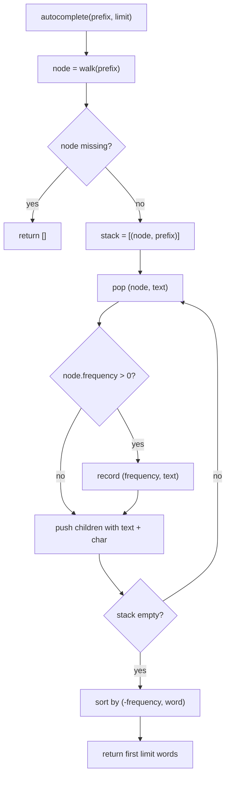
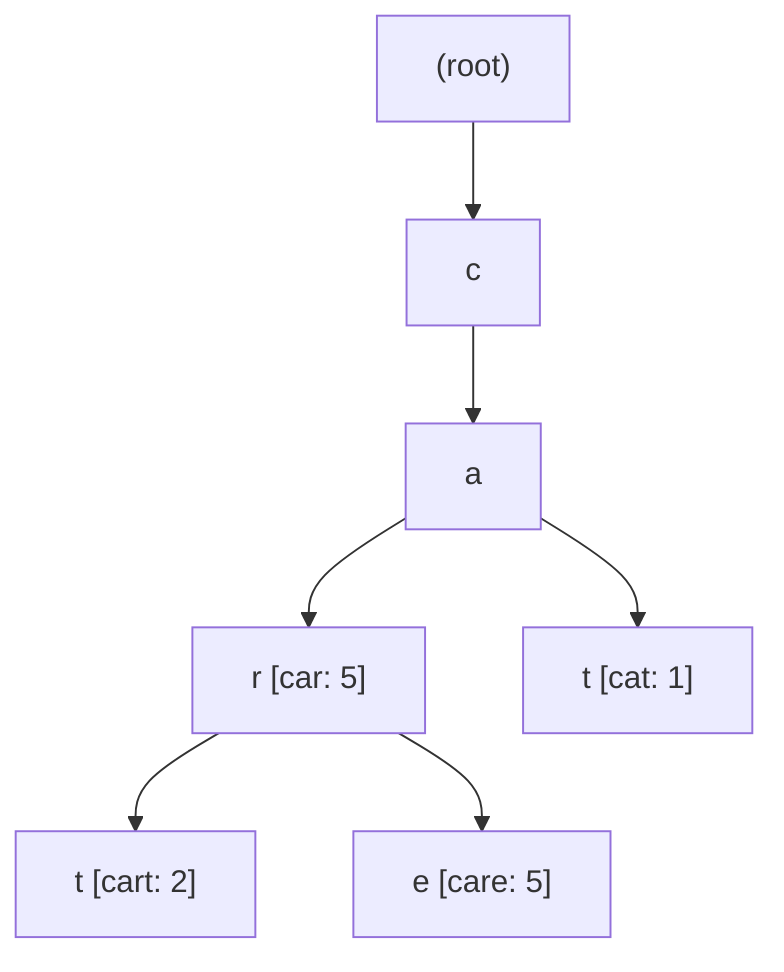

# 14. Trie (prefix tree)

A trie stores words one character at a time. Each path from the root spells out a prefix. Words that share a prefix
share the same nodes. A word is marked at the node where it ends.

Code: [algo_14_trie.py](algo_14_trie.py). Tests: [algo_14_trie_test.py](algo_14_trie_test.py).

## The idea

- Each node has a dictionary of children, one per character.
- Each node has a `frequency`. It is 0 when no word ends there. Otherwise it counts how often the word was inserted.
- To find all words with a prefix, walk to the prefix node, then collect every word under it.

## How it works

Insert a word: walk down from the root, one character at a time. Create missing nodes on the way. At the last node, add
the count to its frequency.

Search: walk down the word. The word exists only if the last node has a frequency above 0.

Starts with: walk down the prefix. It exists if the walk finishes without a missing child.

Autocomplete (prefix, limit):

1. Walk down the prefix. If the walk fails, return an empty list.
2. Collect every node under it that has a frequency above 0, using a stack.
3. Sort by frequency (highest first), then alphabetically for ties.
4. Return the first `limit` words.

## Flow

## Example

Insert `car` (5), `cart` (2), `care` (5), `cat` (1):

- `search("car")` is true. `search("ca")` is false, because no word ends at `a`.
- `starts_with("ca")` is true.
- `autocomplete("ca")` walks to `a`, collects `car`, `cart`, `care`, and `cat`, then sorts:
  `["car", "care", "cart", "cat"]`. `car` and `care` come first, because each has frequency 5.

## Complexity

- `insert`, `search`, `starts_with`: O(L) for a word of length L. The number of stored words does not matter.
- `autocomplete`: O(size of the subtree under the prefix) plus a sort of the matches.

## Why it is useful

A hash table only finds exact keys. A user typing `ca` wants every word that starts with `ca`, and a trie finds those by
walking the prefix, with no scan of the whole word list. Ranking by frequency gives the most likely answers first. A
trie also answers longest-prefix questions, which IP routers use to pick a route.

## Where it shows up

- Search boxes and autocomplete in apps and editors.
- IP routing tables, which use a compressed trie (a radix tree) to find the most specific matching prefix.
- Spell checkers and dictionaries.

## Simplifications in this code

- No compression. A radix tree merges chains of single-child nodes, which saves memory.
- Autocomplete collects the whole subtree before sorting. For very large subtrees, a heap of the top results saves time.
- Characters are plain Python strings, so the code works with any Unicode text.
