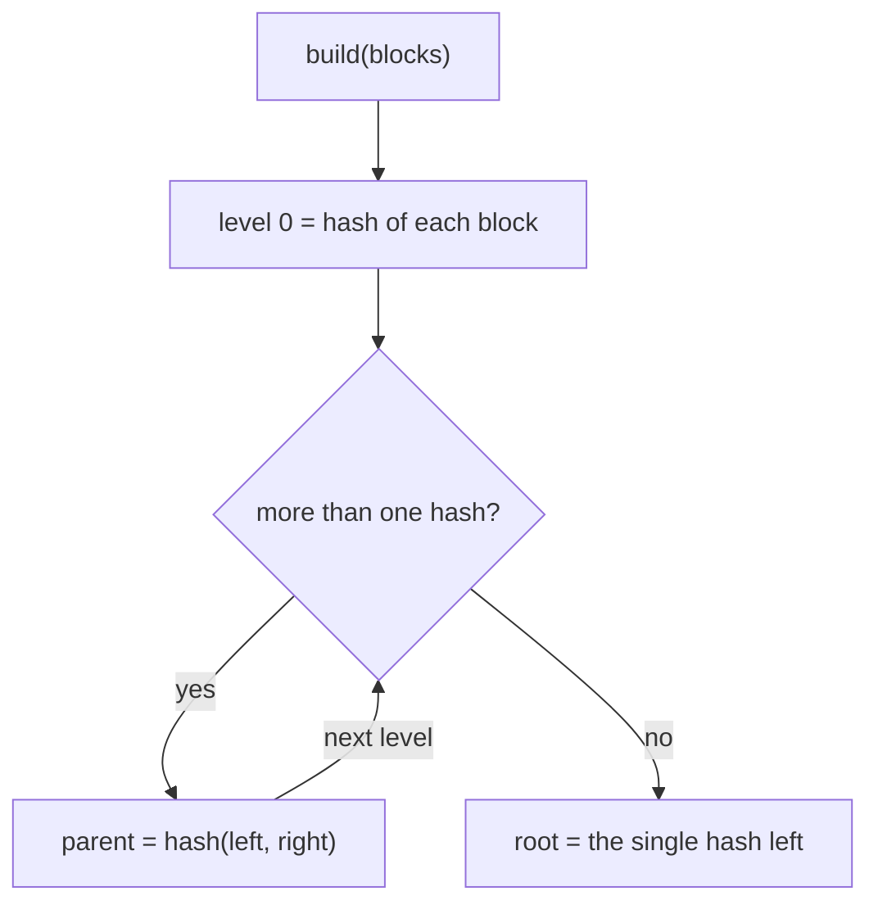
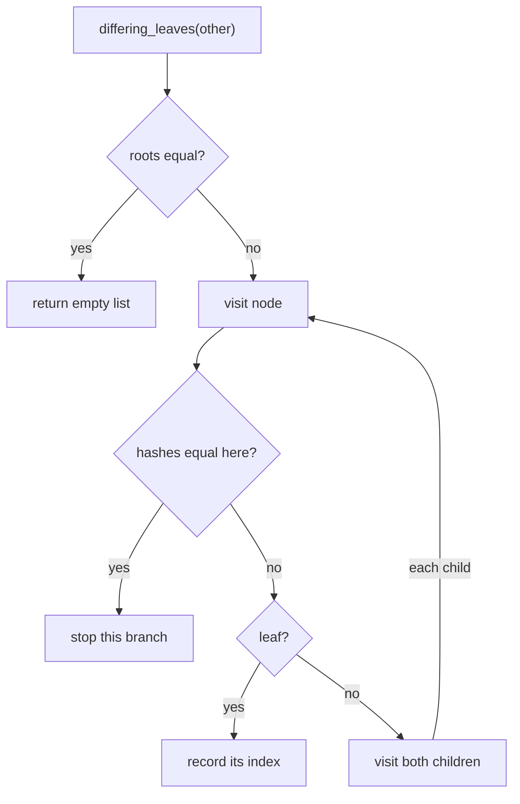
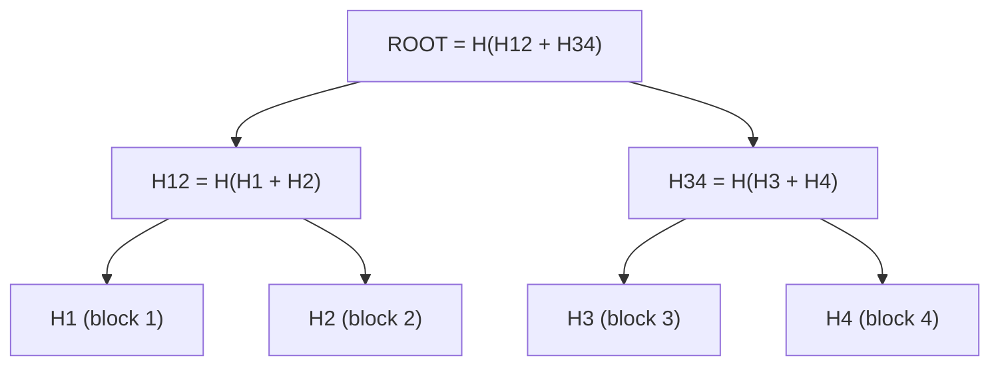

# 15. Merkle tree

A Merkle tree is a binary tree of hashes. Each leaf is the hash of a data block. Each parent is the hash of its two
children. The root hash summarises everything below it, so if any block changes, the root changes too.

Code: [algo_15_merkle_tree.py](algo_15_merkle_tree.py). Tests:
[algo_15_merkle_tree_test.py](algo_15_merkle_tree_test.py).

## The idea

- Two replicas with the same root hash have the same data. They do not need to compare anything else.
- If the roots differ, compare the two children. Follow only the child whose hash differs. Repeat until you reach the
  leaves that changed.
- A **proof** for one block is the list of sibling hashes on the path to the root. Anyone with the root can check the
  proof without the rest of the data.

## How it works

Build:

1. Hash each block to make the leaves.
2. Pair neighbouring hashes, hash each pair, and make a new level.
3. Repeat until one hash is left, the root.
4. If a level has an odd count, its last hash pairs with itself. No padding is stored.

Proof for a leaf: at each level, record the sibling hash and whether the sibling is on the left.

Verify: start from the leaf hash. At each step, hash the sibling and the current value in the right order. Compare the
final value with the root.

Diff: if the roots match, stop. Otherwise, recurse into the two children of each differing node, and collect the leaves
that differ.

## Flow

## Example

Four blocks, with hashes shortened to H1 to H4:

Proof for block 2 (index 1): sibling `H1` on the left, then sibling `H34` on the right. To verify, compute `H(H1 + H2)`,
then `H(H12 + H34)`, and compare with ROOT.

If block 3 changes, only `H3`, `H34`, and ROOT change. Comparing with another replica that has the old block 3:

| Step | Check                       | Outcome                                       |
| ---- | --------------------------- | --------------------------------------------- |
| 1    | Roots                       | differ, so check the children                 |
| 2    | H12 and H34                 | H12 same, H34 differs                         |
| 3    | H3 and H4 (children of H34) | H3 differs, H4 same                           |
| 4    | Result                      | leaf index 2 (block 3) is the only difference |

## Complexity

- Build: O(n) hashes.
- Proof and verify: O(log n) hashes.
- Diff with d changed leaves: about O(d log n) hash comparisons. The cost depends on the changes, not the data size.

## Why it is useful

Syncing two large copies of data is slow if you send everything. A Merkle tree finds the differences by sending only
hashes, so two replicas exchange a few hashes and then copy only the blocks that differ. A proof also lets a client
check one item against a root it trusts, without downloading the whole dataset.

## Where it shows up

- Dynamo and Cassandra use Merkle trees for anti-entropy, which is background repair between replicas.
- Git uses the same idea for commits and trees.
- Certificate transparency logs and blockchains use it for proofs of inclusion.

## Simplifications in this code

- The tree is built in one pass. Real systems update only the changed branches.
- The diff assumes both trees have the same number of leaves. Real systems also handle key ranges that differ.
- Hashes use SHA-256 with no domain tag between leaves and inner nodes. Production designs add a prefix to keep the two
  apart.
