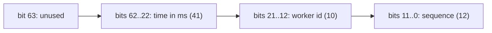
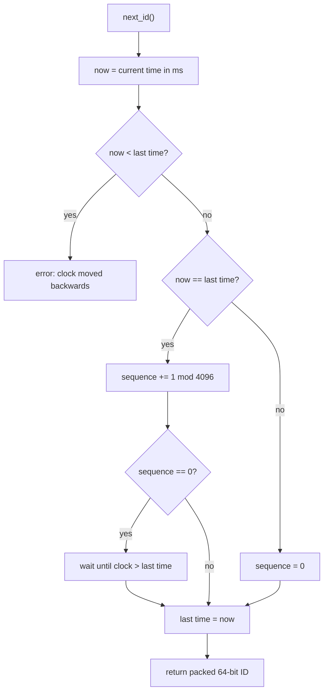

# 16. Snowflake-style IDs

A Snowflake-style ID is a 64-bit number built from three parts: the time, the machine (worker) number, and a sequence
counter. Each machine makes IDs on its own. No central service hands them out, and IDs from different machines do not
collide.

Code: [algo_16_snowflake_id.py](algo_16_snowflake_id.py). Tests:
[algo_16_snowflake_id_test.py](algo_16_snowflake_id_test.py).

## The idea

The bit layout, from the highest bit to the lowest:

- **Time** comes first, so later IDs are bigger. Sorting by ID sorts by creation time, roughly.
- **Worker id** is set once per machine. Two machines with different ids cannot make the same ID.
- **Sequence** counts IDs made in the same millisecond. It goes up to 4095.

## How it works

`next_id`:

1. Read the current time in milliseconds.
2. If the clock went backwards, raise an error. Going back would make duplicate times possible.
3. If the time is the same as last time, add 1 to the sequence.
4. If the sequence wraps to 0, all 4096 slots in this millisecond are used. Wait until the clock moves on.
5. If the time is new, reset the sequence to 0.
6. Pack the bits: time, then worker, then sequence.

## Flow

## Example

Worker 5 at time T (in ms since the epoch), three IDs in the same millisecond:

| ID   | Time | Worker | Sequence |
| ---- | ---- | ------ | -------- |
| id 1 | T    | 5      | 0        |
| id 2 | T    | 5      | 1        |
| id 3 | T    | 5      | 2        |

Then time T+1: the sequence resets to 0. The ID is bigger, because the time bits are bigger.

Decode any ID with the time, worker, and sequence fields. Bits 21 to 12 always give the worker id.

## Complexity

- `next_id`: O(1) in the normal case. When more than 4096 IDs are needed in one millisecond, it waits for the next
  millisecond, which takes under a millisecond.

## Why it is useful

Generating IDs in a database with auto-increment makes one database the bottleneck, and it is a single point of failure.
Random UUIDs avoid that, but they sort randomly, which hurts index locality in databases. A Snowflake ID needs no
coordination, stays unique across machines, and is roughly ordered by time, so new rows are added near the end of a
sorted index.

## Where it shows up

Twitter's original scheme, and similar IDs in Discord, Instagram, and many internal ID services.

## Simplifications in this code

- The epoch is fixed at 2024-01-01 UTC. The 41-bit time field runs out about 69 years after the epoch.
- The worker id is given by the caller. Real systems assign it from a config service or from a coordination store.
- Clock rollback raises an error. Some systems wait instead, or refuse to start until the clock is correct.
