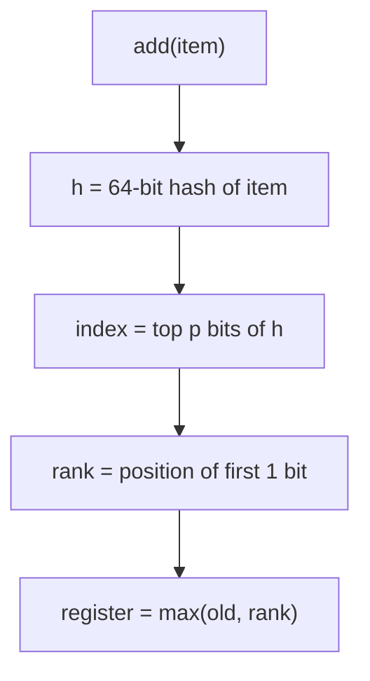
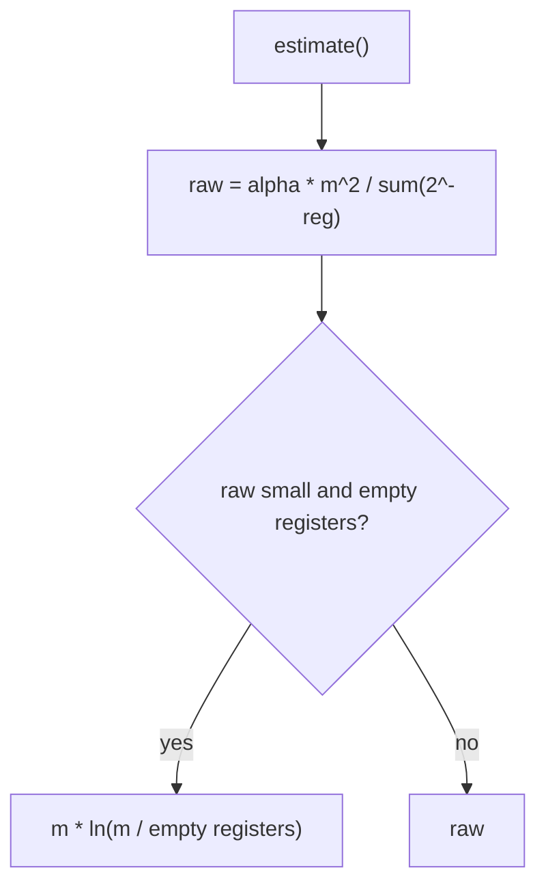

# 17. HyperLogLog

HyperLogLog estimates how many distinct items it has seen. It uses a few kilobytes, no matter whether it saw a thousand
items or a billion. The error is small, about 1% with the default precision.

Code: [algo_17_hyperloglog.py](algo_17_hyperloglog.py). Tests:
[algo_17_hyperloglog_test.py](algo_17_hyperloglog_test.py).

## The idea

Hash each item to a 64-bit number. Hash bits look random, so some patterns are rare:

- A hash that starts with many zeros is rare. Seeing one suggests you have seen many items.
- The **rank** of a hash is the position of its first 1 bit, counting from the left, starting at 1. A rank of 4 means
  three zeros came before the first 1. It is rare, so a high rank hints at a large count.

HyperLogLog splits the hashes into `m = 2^p` groups, called registers. The top `p` bits pick the register. Each register
keeps the highest rank it has seen. The estimate combines all the registers.

## How it works

Add an item:

1. Hash the item to 64 bits.
2. The top `p` bits give the register index.
3. The remaining bits give the rank: the position of the first 1 bit, starting at 1.
4. Store the rank in that register if it is higher than the current value.

Estimate:

1. Compute the harmonic mean of the registers: `2^-value` summed over all registers.
2. Multiply by `alpha(m) * m^2`, a correction constant.
3. If the result is small and some registers are still empty, use linear counting instead. It is more accurate for small
   counts.

## Flow

## Example

Four registers (`p = 2`), with these values after many adds:

| Register | 0   | 1   | 2   | 3   |
| -------- | --- | --- | --- | --- |
| Value    | 3   | 1   | 5   | 2   |

Sum of `2^-value`: 1/8 + 1/2 + 1/32 + 1/4 = 0.906. With `alpha` = 0.568 for four registers, the raw estimate is about
0.568 * 16 / 0.906 = 10. The estimate is about 10 distinct items.

Merge: two sketches of the same precision can be merged by taking the max of each register. The result estimates the
size of the union, so you can count visitors across servers and combine the results.

## Complexity

- `add`: O(1). One hash and one comparison.
- `estimate`, `merge`: O(m), where m is the number of registers.
- Memory: 2^p small numbers. With p = 14, that is about 16 KB, and the error is about 0.8%.

## Why it is useful

Counting distinct items exactly needs a set that holds every item, which can take gigabytes for big data. HyperLogLog
answers "how many unique visitors this month?" within a percent or so, in a fixed small amount of memory. Sketches merge
cheaply, so each server can count on its own and the results can be combined later.

## Where it shows up

- Redis `PFADD` and `PFCOUNT` commands.
- Unique-visitor and distinct-query counts in analytics systems such as Google's BigQuery (`APPROX_COUNT_DISTINCT`) and
  Presto.

## Simplifications in this code

- Only the basic estimator and small-range correction are used. Production versions add a large-range correction and
  bias tables for small precisions.
- The hash is SHA-256 truncated to 64 bits, which is slower than the hash functions used in production.
