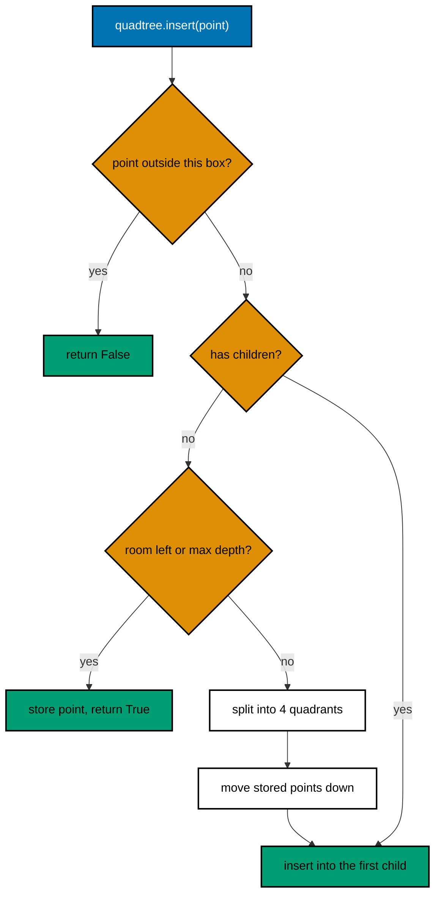
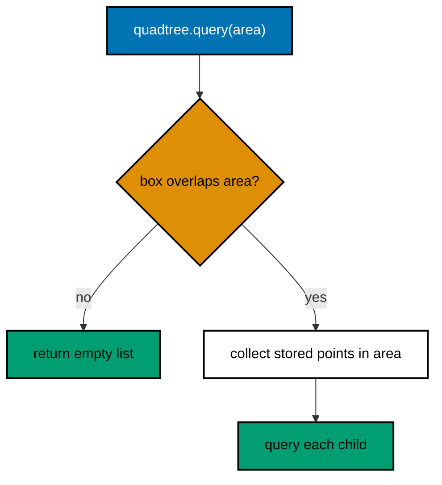
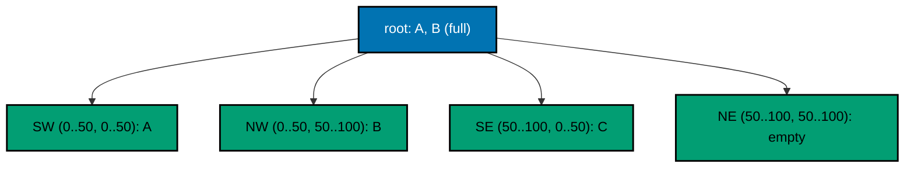

# 18. Geohash and quadtree

Both structures turn two-dimensional location data into something a database can search quickly:

- A **geohash** turns a (latitude, longitude) pair into a short string. Points that are close usually share a prefix.
- A **quadtree** splits a map box into four smaller boxes when one gets too full. A box query only visits the boxes that
  overlap it.

Code: [algo_18_geohash_quadtree.py](algo_18_geohash_quadtree.py). Tests:
[algo_18_geohash_quadtree_test.py](algo_18_geohash_quadtree_test.py).

## The idea: geohash

Each step cuts the current range in half and records which half holds the point:

1. Start with latitude in [-90, 90] and longitude in [-180, 180].
2. Take turns: split longitude, then latitude, then longitude, and so on.
3. Each split adds one bit: 1 for the upper half, 0 for the lower half.
4. Every 5 bits become one character from the alphabet `0123456789bcdefghjkmnpqrstuvwxyz`.

More characters means a smaller cell. Two points in the same cell share the same prefix.

| Step         | Axis        | Check                                    | Bit           |
| ------------ | ----------- | ---------------------------------------- | ------------- |
| Start        | lon and lat | lon [-180 ... 180], lat [-90 ... 90]     | -             |
| 1            | lon         | point lon 10.4 is in the upper half      | 1             |
| 2            | lat         | point lat 57.6 is in the upper half      | 1             |
| 3            | lon         | 10.4 is in the lower half of [0 ... 180] | 0             |
| ...          | ...         | ...                                      | ...           |
| Every 5 bits | -           | -                                        | One character |

## How it works: geohash

Encode: repeat the splitting for each bit, keep the bounds, and map each 5-bit group to a character.

Decode: read the characters back into bits, and apply the same splits. The center of the final cell is the answer. The
cell is small, so the center is close to the original point.

## The idea: quadtree

A quadtree holds points in boxes:

1. A box holds up to `capacity` points. Inserts go into it while it has room.
2. When a full box gets another point, split it into four equal quadrants.
3. Move the points into the quadrants. Later inserts go to the quadrant that contains them.
4. Stop splitting at a maximum depth. This stops endless splits when many points share one position.

A query for a rectangle skips every box that does not overlap it.

## Flow

## Example

A box `(0, 0) to (100, 100)` with capacity 2. Insert `A(10, 10)`, `B(20, 80)`, `C(70, 30)`:

Insert A and B: the root holds both. Insert C: the root is full, so it splits into four quadrants:

Query (0..30, 0..30): NE does not overlap, so skip it. Check SW: A is inside.

## Complexity

- Geohash encode and decode: O(precision), a fixed number of steps.
- Quadtree insert and query: about O(log n + k) for k results, when points are spread out. Clusters make the tree
  deeper, so depth is capped.

## Why it is useful

A normal database index on latitude and longitude does not handle "within 2 km" well. It can index only one dimension at
a time, so it returns a wide strip and a second filter does the rest. A geohash turns the area into a string prefix, so
a normal string index can answer "nearby" with a prefix range. A quadtree adapts to where the points are: dense cities
get small boxes and empty areas get large ones.

## Where it shows up

- Ride-hailing and delivery apps: "drivers near me".
- Redis `GEOADD` and `GEOSEARCH` store positions as geohash-style scores.
- MongoDB's 2dsphere index and Elasticsearch's geo features use tree or grid structures of the same kind.

## Simplifications in this code

- Geohash prefix search is not implemented. Only encode and decode are. Nearby cells on a boundary can have very
  different prefixes, so a real search checks the neighbouring cells too.
- The quadtree stores points in memory, and it does not remove points.
- Distances are in degrees, not kilometres. Real code converts to metres on the sphere.
