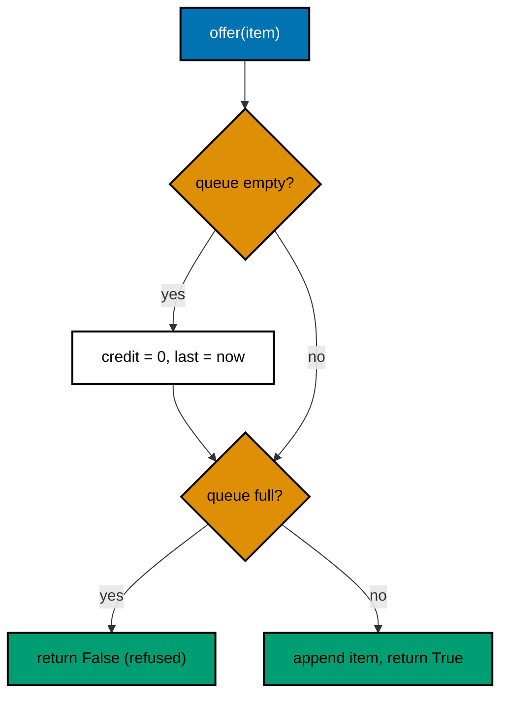
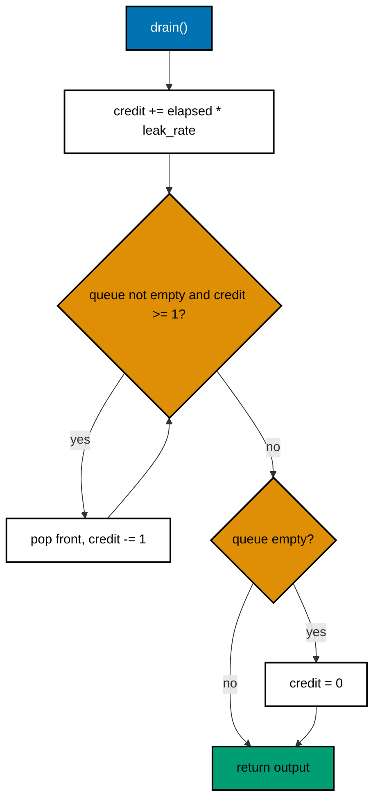

# 19. Leaky bucket queue

A leaky bucket is a queue with a fixed size and a fixed drain rate. Items wait in the bucket. Items leave at a steady
rate. When the bucket is full, new items are refused. The output rate stays the same even when the input comes in
bursts.

Code: [algo_19_leaky_bucket.py](algo_19_leaky_bucket.py). Tests:
[algo_19_leaky_bucket_test.py](algo_19_leaky_bucket_test.py).

## The idea

- **Capacity** is the most items the queue can hold.
- **Leak rate** is how many items may leave per second.
- A bucket that is empty does not build up credit. Time spent idle does not turn into a burst later.

This is different from the [token bucket](algo_10_token_bucket.md). A token bucket lets a burst through right away. A
leaky bucket queues the burst and sends it at a steady rate.

## How it works

Offer an item:

1. If the queue was empty, reset the credit to 0 and start the timer from now.
2. If the queue is full, refuse the item and return `False`.
3. Otherwise, add the item to the back of the queue and return `True`.

Drain (called by the sender):

1. Add credit for the time since the last drain: `elapsed * leak_rate`.
2. While credit is at least 1 and the queue is not empty, remove the front item and subtract 1 from the credit.
3. If the queue is now empty, reset the credit to 0, so no burst builds up.
4. Return the items that were removed, oldest first.

## Flow

## Example

Capacity 3, leak rate 2 items per second.

| Time | Call     | Result            | Queue after |
| ---- | -------- | ----------------- | ----------- |
| 0.0  | offer(a) | True              | [a]         |
| 0.0  | offer(b) | True              | [a, b]      |
| 0.0  | offer(c) | True              | [a, b, c]   |
| 0.0  | offer(d) | False (full)      | [a, b, c]   |
| 1.0  | drain()  | [a, b] (credit 2) | [c]         |
| 1.5  | drain()  | [c] (credit 1)    | []          |

## Complexity

- `offer`: O(1).
- `drain`: O(k) for k released items.

## Why it is useful

A downstream service often has a fixed capacity. A burst of requests can overwhelm it and make everything slow. A leaky
bucket puts a steady limit on the output, so the service sees an even load. The full queue acts as backpressure: the
sender learns right away that it must slow down or retry later, instead of the system falling over.

## Where it shows up

- Network traffic shaping and queueing on routers.
- Outbound notification systems that send at a limited rate to email or SMS providers.
- Protecting a slow database or third-party API from bursts.

## Simplifications in this code

- No background timer. Items leave only when the caller calls `drain()`.
- Items are kept in memory. Nothing is lost on a crash, and nothing is persisted.
- Refused items are simply returned as `False`. A real system decides whether to retry, drop, or send an error back.
