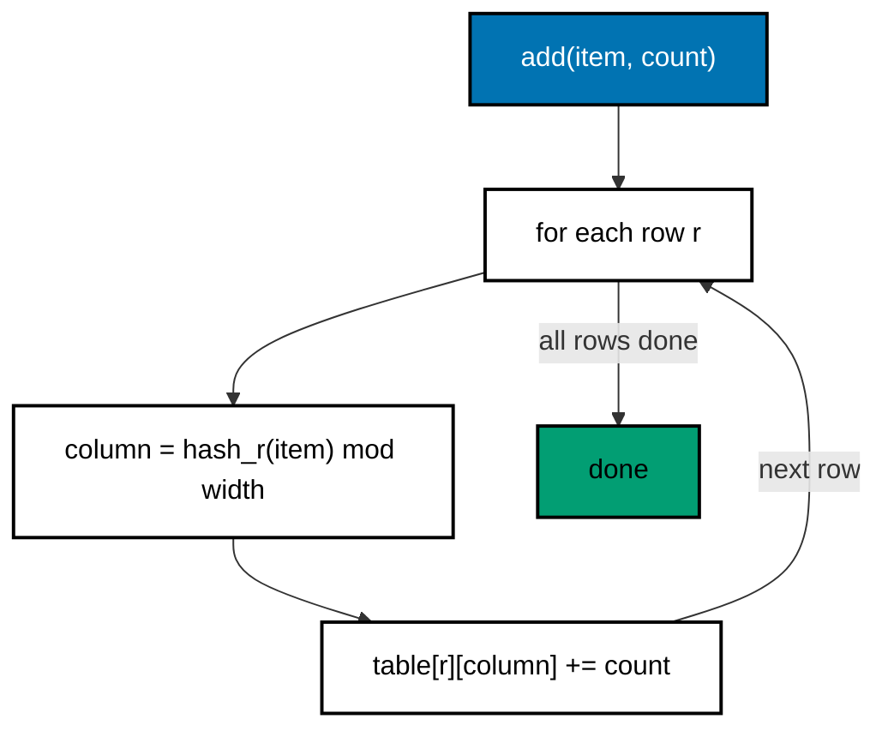
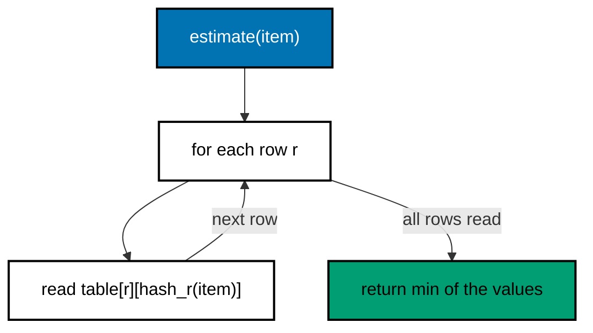

# 20. Count-min sketch

A count-min sketch estimates how often each item appears in a stream. It uses a fixed grid of counters, so memory does
not grow with the number of distinct items. It never undercounts. It can overcount, when different items share a
counter.

Code: [algo_20_count_min_sketch.py](algo_20_count_min_sketch.py). Tests:
[algo_20_count_min_sketch_test.py](algo_20_count_min_sketch_test.py).

## The idea

The sketch is a grid with `depth` rows and `width` columns. Each row has its own hash function.

- **Add** an item: in every row, hash the item to one column and add the count to that cell.
- **Estimate** an item: in every row, find its cell, then take the smallest value. A cell can only get too big, because
  other items may share it. Taking the minimum removes most of that error.

`HeavyHitters` keeps the top `k` items on top of the sketch, using a min-heap of candidates.

## How it works

Add (item, count):

1. For each row `r`, compute the column `h_r(item)`.
2. Add `count` to `table[r][column]`.

Estimate (item):

1. For each row, read `table[r][h_r(item)]`.
2. Return the minimum of those values.

Heavy hitters (`observe`):

1. Add the item to the sketch and get its new estimate.
2. If the item is already a candidate, or there is room for more candidates, store the new estimate.
3. Otherwise, compare with the smallest candidate on the heap. If the new estimate is larger, swap them.

## Flow

## Example

A sketch with 3 rows and 8 columns. Assume these column choices (illustrative):

Start with every cell at 0. Then:

| Call          | Cells updated                                           | Effect            |
| ------------- | ------------------------------------------------------- | ----------------- |
| add("cat", 3) | row 0 col 2, row 1 col 5, row 2 col 0                   | each becomes 3    |
| add("dog", 2) | row 0 col 6, row 1 col 5 (shares with cat), row 2 col 4 | each goes up by 2 |

After both adds, the grid is:

| Row   | Col 0 | Col 1 | Col 2 | Col 3 | Col 4 | Col 5 | Col 6 | Col 7 |
| ----- | ----- | ----- | ----- | ----- | ----- | ----- | ----- | ----- |
| Row 0 | 0     | 0     | 3     | 0     | 0     | 0     | 2     | 0     |
| Row 1 | 0     | 0     | 0     | 0     | 0     | 5     | 0     | 0     |
| Row 2 | 3     | 0     | 0     | 0     | 2     | 0     | 0     | 0     |

Estimates:

| Call            | Row 0 cell        | Row 1 cell        | Row 2 cell | Minimum | Result                       |
| --------------- | ----------------- | ----------------- | ---------- | ------- | ---------------------------- |
| estimate("cat") | col 2 = 3         | col 5 = 5 (3 + 2) | col 0 = 3  | 3       | exact                        |
| estimate("fox") | col 6 = 2 (dog's) | col 1 = 0         | col 7 = 0  | 0       | correct, fox was never added |

The shared cell in row 1 was too big for cat, but row 0 and row 2 were exact. The minimum fixes it.

## Complexity

- `add`, `estimate`: O(depth).
- Memory: width * depth counters. Setting `width = e / epsilon` and `depth = ln(1 / delta)` gives an overcount of at
  most `epsilon * total` with probability `1 - delta`.
- Heavy hitters: O(log k) per observe, for the heap work.

## Why it is useful

Counting every distinct item in a huge stream needs memory that grows with the number of items. A count-min sketch uses
a fixed budget, so it works on streams that never end. Because it never undercounts, a "hot" check based on it does not
miss a real hot item. The heavy-hitters wrapper finds the top items without storing every item.

## Where it shows up

- Finding hot keys in a cache or a load balancer, so they can be replicated.
- Trending topics and top talkers in network monitoring and streaming analytics.
- Many stream-processing libraries include a count-min sketch for approximate frequency counts.

## Simplifications in this code

- Items are strings, and each row hashes the row number plus the item with BLAKE2b.
- The heavy-hitters heap can hold stale entries until they reach the top. This keeps the code short, and it is correct,
  but it uses extra memory when one item is updated many times.
- Counts are only added, never subtracted.
