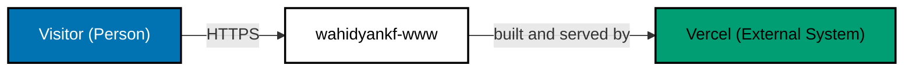
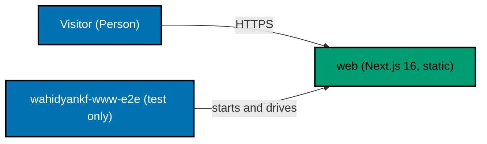
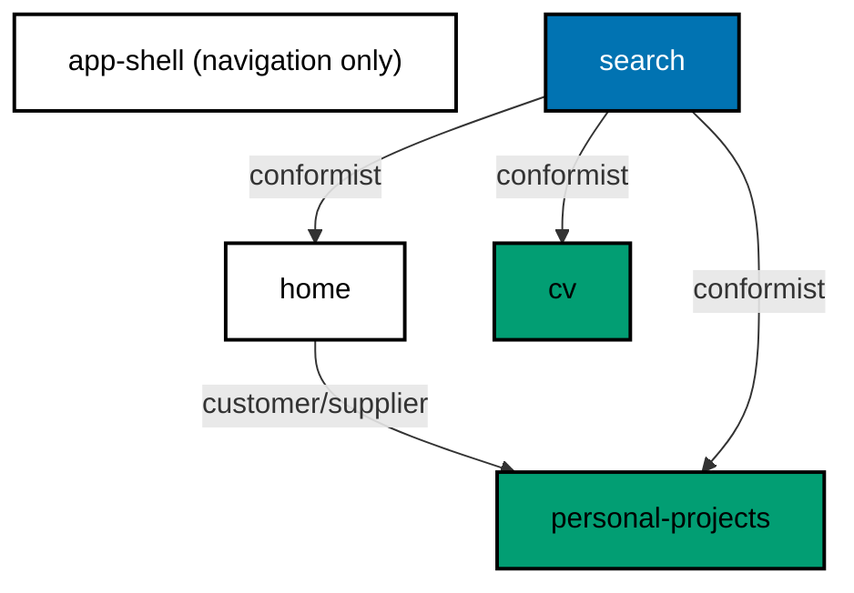

# wahidyankf-www — Architecture

The as-built C4 model for `wahidyankf-www`, a personal portfolio and CV site. Its executable behaviour lives in
[behaviours/](behaviours/README.md); this document describes the boundaries those scenarios exercise.

The site is fully static. No server-side code runs at request time, every page is rendered at build time, and no user
data is collected, stored, or transmitted beyond the access logs the CDN keeps. That single constraint is why several
boundaries a portfolio site might be expected to have are absent below rather than merely undocumented: there is no API,
no database, no session, and no authentication to draw.

## Scope

One deployable application and one test-only E2E project bind the corpus.

| Project                   | Role                                                                           |
| ------------------------- | ------------------------------------------------------------------------------ |
| `apps/wahidyankf-www`     | The Next.js application plus Unit and Integration adapters.                    |
| `apps/wahidyankf-www-e2e` | The test-only Playwright adapter; it depends one-way on the owner application. |

## People and External Systems

| Actor   | Description                                                                           |
| ------- | ------------------------------------------------------------------------------------- |
| Visitor | An anonymous browser user. There is nothing to authenticate as; every page is public. |

One external system:

- **Vercel** — Builds the site from `main` and serves it, terminating TLS and holding the edge cache. A build runs only
  when the `ignoreCommand` in `vercel.json` sees the promotion branch.

## System Context

## Containers

One container. There is no backend, no database, and no message bus; all content is TypeScript bundled at build time.

| Container | Technology | Deployment     | Description                                                               |
| --------- | ---------- | -------------- | ------------------------------------------------------------------------- |
| `web`     | Next.js 16 | Vercel, static | The whole site: every route, the client-side search index, the CV record. |

The E2E adapter is drawn because it is a real process boundary: it starts the application through `next start` and
drives it over HTTP through a browser, which is a different toolchain from the in-process behaviour adapter. It is not a
container, which is why the count above still reads one: it exists only at test time and is never deployed. The BDD
policy requires this public boundary to live in its dedicated E2E project.

## Components

The application is organized by feature, each component under `src/features/<component>/`, with routes in `src/app/`.

| Component           | Responsibility                                                                  |
| ------------------- | ------------------------------------------------------------------------------- |
| `app-shell`         | Navigation chrome: sidebar on desktop, bottom tab bar on mobile.                |
| `home`              | The landing page — top skills, languages, frameworks, and the about-me summary. |
| `cv`                | The CV page and the CV record itself.                                           |
| `personal-projects` | The projects listing and its technology-tag filter.                             |
| `search`            | Client-side search across every other component's content.                      |
| `ui/shell`          | The presentation primitives the shell renders — inlined during the migration.   |
| `env/core`          | Tier-aware environment loading — inlined during the migration.                  |

`search` is a conformist to the three components it indexes: it reads their content as they publish it and imposes no
shape on them, so adding a field to the CV record cannot break search's contract, only its results.

## Data Stores

One, and it is not a database.

- **CV record**
  - Location: `src/features/cv/core/data.ts`
  - Description: The single authoritative CV record in this repository. It is TypeScript compiled into the bundle, not
    data fetched at runtime.

That it is the _only_ one is load-bearing rather than incidental. Before the migration this repository also kept a `cv/`
directory at its root, and two records of the same career are a guarantee of eventually publishing the stale one. The
migration deleted `cv/` and left this store as the single source.

## Boundaries

**Process.** One at build time: Next.js reads the TypeScript sources and emits static output. One at test time: the E2E
adapter starts a server process and speaks to it over a local port. None at request time — a served page runs no code of
ours.

**Network.** The visitor reaches Vercel's edge over HTTPS and nothing else. The application makes no outbound calls: no
analytics, no API, no font or asset fetch from a third party. Fonts are bundled.

**Trust.** There is no privilege boundary inside the application, because there is no authentication, no session, and no
user input that reaches a server. The one boundary that matters is deployment: `vercel.json` gates every build on the
`prod-wahidyankf-www` branch, so `main` moving does not move the site.

**Environment.** `env/core` resolves which tier's env file to read and refuses to fall through to a developer's local
file when the tier is anything other than `local`. The E2E adapter pins its tier explicitly for the same reason.

## Behaviour Traceability

| Feature                                                           | Component it exercises                       |
| ----------------------------------------------------------------- | -------------------------------------------- |
| [accessibility.feature](behaviours/accessibility.feature)         | `app-shell`, and every page it frames        |
| [cv.feature](behaviours/cv.feature)                               | `cv`                                         |
| [env-loader.feature](behaviours/env-loader.feature)               | `env/core`                                   |
| [home.feature](behaviours/home.feature)                           | `home`                                       |
| [personal-projects.feature](behaviours/personal-projects.feature) | `personal-projects`                          |
| [responsive.feature](behaviours/responsive.feature)               | `app-shell`                                  |
| [search.feature](behaviours/search.feature)                       | `search`                                     |
| [static-filterable-routes.feature][static-routes]                 | `personal-projects`, at the routing boundary |
| [theme.feature](behaviours/theme.feature)                         | `ui/shell`                                   |
| [tier-env-loading.feature](behaviours/tier-env-loading.feature)   | `env/core`                                   |

[static-routes]: behaviours/static-filterable-routes.feature
